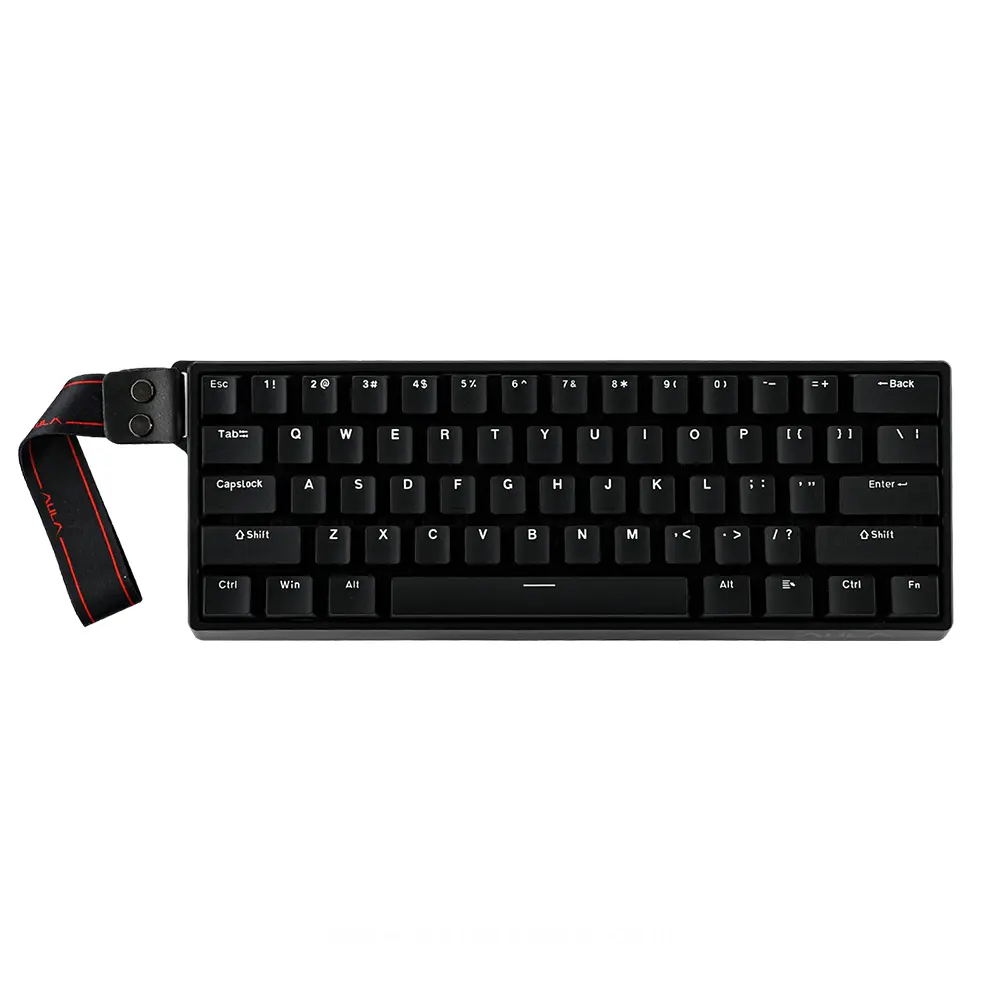
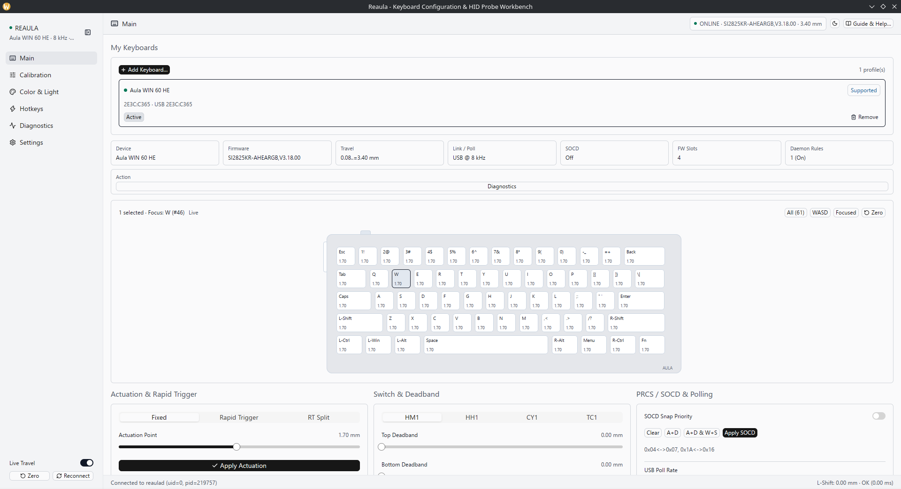
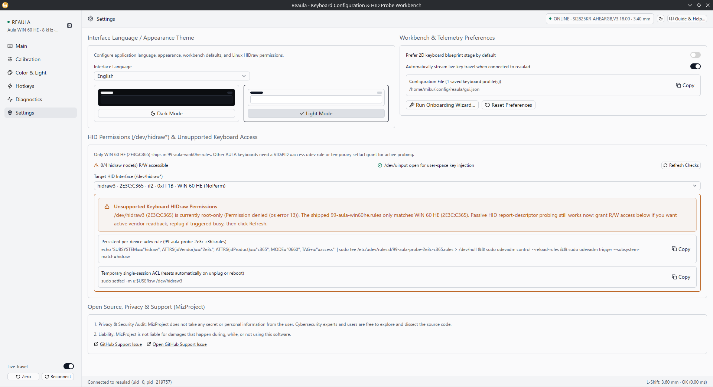
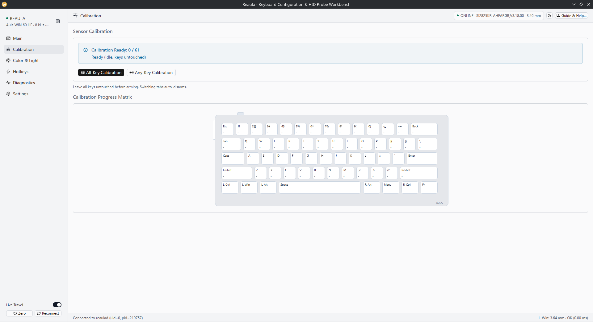
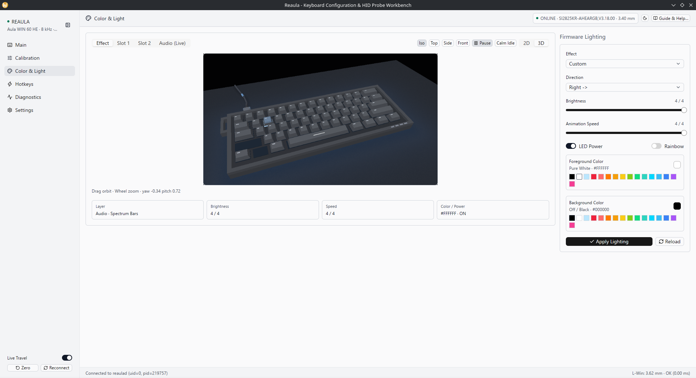
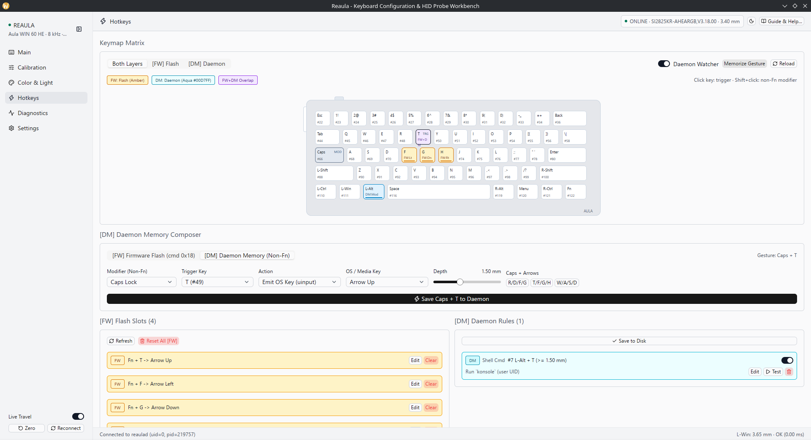
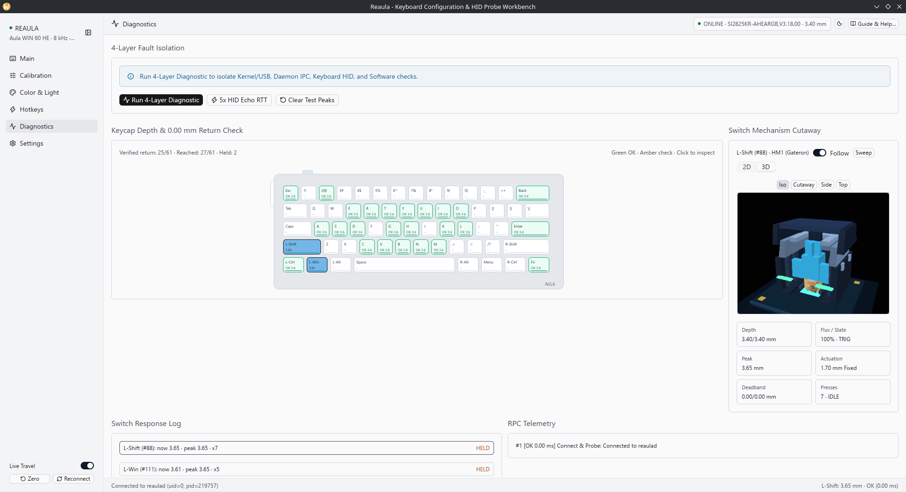

<p align="center">
  
</p>

<h1 align="center">Atrium</h1>

<p align="center">
  Linux userspace driver suite, privilege-isolated HID daemon, CLI, TUI, and GPUI + wgpu desktop workbench for <strong>AULA Hall-effect &amp; RGB keyboards</strong>.
  <br />
  Licensed under <strong>GNU Affero General Public License v3.0 or later (AGPL-3.0-or-later)</strong>.
</p>

## Workspace Components

- **`crates/atrium-core`**: Indexed keyboard catalog (`keyboards/`), WIN 60 HE HID wire codec & `hidapi` driver, sysfs HID inspector & safe probe builder (`hid_probe`), ALSA audio capture & 14-band FFT/beat engine (`audio_fx`), 4-layer diagnostics, shared AGPLv3 notices (`legal`), and `SO_PEERCRED`-secured Unix socket IPC.
- **`crates/atrium-daemon` (`atriumd`)**: Single-owner USB/HID background daemon exposing a UID-restricted Unix socket (`/run/atrium/atriumd.sock`), indexed driver registry, in-memory Hall-effect shortcut/Fn watcher (`evdev` + `uinput`), systemd `Type=notify` + watchdog integration, and persistent daemon-hosted Audio Equalizer RGB engine.
- **`crates/atrium-cli` (`atrium`)**: CLI connecting through `atriumd` (or directly via `--direct`, prompting for `sudo` when `hidraw` permissions require it), plus `doctor`, `daemon systemd`, `audio`, and `about`.
- **`crates/atrium-tui` (`atrium-tui`)** *(experimental / incomplete)*: Early-stage `ratatui` terminal client. Not yet properly developed and still has known bugs; prefer `atrium-gui` or CLI commands for reliable control.
- **`crates/atrium-gui` (`atrium-gui`)**: Native GPUI Kit + `wgpu` desktop workbench featuring live 61-key travel monitoring, 3D keyboard & switch-cutaway visualizations (with 2D fallbacks), unsupported-keyboard HID probing with 3D generic preview, multi-language support, Light/Dark clinical themes, and an offline AGPLv3 About & License viewer.

## Supported & Probeable Hardware

| Model | USB VID:PID | Status | Preview |
| :--- | :--- | :--- | :---: |
| **AULA WIN 60 HE** | `2E3C:C365` | Full driver support (Calibration, Actuation/RT, 4-Slot Switch Profiles, Deadbands, SOCD, 1-8 kHz Poll, Firmware RGB, Custom Slots, Audio EQ, `[FW]` + `[DM]` Keymaps) |  |
| **Unsupported AULA / HID Boards** | User-selected `/dev/hidraw*` | Generic 3D probe stage + sanitized capability JSON exporter + GitHub Issue submission workflow (includes per-device `udev`/`setfacl` permission helper) | Generic Keyboard 3D Stage |

## Desktop GUI (`atrium-gui`) Screenshots

### Keyboard Hub, Hardware Profiles & Settings
| Main Workbench & Hardware Manager | Software Settings & Setup Preferences |
| :---: | :---: |
|  |  |

### Sensor Calibration & Lighting Studio
| Live Key Travel & Calibration Matrix | 3D RGB Lighting & Audio-Reactive Visualizer |
| :---: | :---: |
|  |  |

### Dual-Layer Hotkeys & 4-Layer Diagnostics
| Firmware & Daemon Hotkeys | 4-Layer Diagnostics & 3D Switch Cutaway |
| :---: | :---: |
|  |  |

## Build & Package

Native Linux dependencies required for building: `libhidapi-dev`, `libudev-dev`, `libasound2-dev`, and a working Rust toolchain.

```bash
cargo build --workspace --bins
# Or run full lint + unit tests + release tarball packaging + SHA256 checksums:
python3 atrium_build.py all
```

## Quick Start

Start the single-owner background daemon (handles root HID access while keeping clients unprivileged via `SO_PEERCRED`):

```bash
cargo run -- daemon start
cargo run -- daemon status
```

Alternatively, initialize and manage `atriumd` cleanly as a `systemd` `Type=notify` service (with watchdog & socket activation support via unit templates in `systemd/`):

```bash
# Install and start system template unit (atriumd@<user>.service):
cargo run -- daemon systemd install --enable --start
cargo run -- daemon status --systemd

# Or install a rootless user session unit (once udev grants /dev/hidraw*):
cargo run -- daemon systemd install --user --enable --start
```

Run any frontend without `sudo` while `atriumd` is active:

```bash
cargo run -- probe
cargo run -- doctor
cargo run -- about          # display AGPLv3 notice, credits & contacts
cargo run -- gui            # or cargo run -p atrium-gui (primary desktop UI)
cargo run -- gui --setup    # reopen the Onboarding / Unsupported HID Probe wizard
cargo run -- tui            # or cargo run -p atrium-tui (experimental)
```

> **TUI status warning**: `atrium-tui` is not yet properly developed and still has bugs (layout clipping, incomplete focus/input edge cases, and unpolished views). Prefer `atrium-gui` or CLI commands for reliable daily configuration.

List all compiled keyboard models indexed into the workspace:

```bash
cargo run -p atrium-daemon -- --list-keyboards
```

### Daemon Audio-Reactive RGB (CLI / Persistent across Exit)

`atriumd` captures desktop/mic audio via a privilege-dropped child helper (`--capture-pcm`) and streams analyzed 14-band FFT/beat frames to the keyboard so effects continue running after closing the GUI, TUI, or detached CLI:

```bash
atrium audio devices
atrium audio start --source monitor --effect spectrum --palette aurora
atrium audio status --watch   # Ctrl+C detaches without stopping keyboard RGB
atrium audio stop             # stops and restores previous keyboard lighting
```

> **Hardware notice**: AULA states WIN 60 HE does not officially support audio rhythm lighting. Continuous per-key `cmd 0x09` streaming is an experimental feature and may reduce LED lifespan on some units; use at your own risk (`atrium-gui` requires reading and accepting a 10-second liability confirmation first).

Stop `atriumd` cleanly when finished:

```bash
cargo run -- daemon stop
```

## Optional: Direct Non-Root Access (`udev` Rule)

To run `--direct` HID commands or run `atriumd` without `root` prompts, install the provided `udev` rule (or use the per-device rule generated inside `atrium-gui` Setup / Settings):

```bash
sudo cp udev/99-aula-win60he.rules /etc/udev/rules.d/
sudo udevadm control --reload-rules && sudo udevadm trigger --subsystem-match=hidraw
```

If an unsupported keyboard behaves unexpectedly during HID probing, unplug and replug it, then try resetting it if supported by holding **Fn + Esc for 10 seconds**.

## Contributors

See [CONTRIBUTING.md](CONTRIBUTING.md) for architecture notes and how to index a new AULA keyboard model.

## License & Legal Notices

```text
Copyright (C) 2026 MizProject Philippines

This program is free software: you can redistribute it and/or modify
it under the terms of the GNU Affero General Public License as published
by the Free Software Foundation, either version 3 of the License, or
(at your option) any later version.

This program is distributed in the hope that it will be useful,
but WITHOUT ANY WARRANTY; without even the implied warranty of
MERCHANTABILITY or FITNESS FOR A PARTICULAR PURPOSE.  See the
GNU Affero General Public License for more details.

You should have received a copy of the GNU Affero General Public License
along with this program.  If not, see <https://www.gnu.org/licenses/>.
```

See the full license text in [LICENSE](LICENSE).

## Contact

- **Email**: mizproject@proton.me
- **Telegram**: [@Mizumo_prjkt](https://t.me/Mizumo_prjkt)
- **Repository & Issues**: [github.com/MizProject/atrium](https://github.com/MizProject/atrium)
